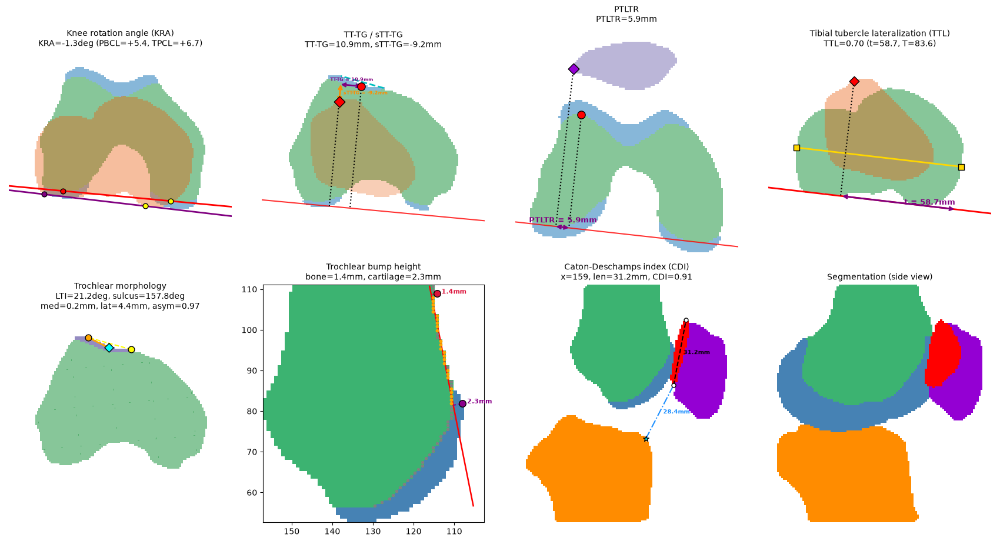

<h1 align="center">KAMINO</h1>

<p align="center"><b>K</b>nee <b>A</b>natomy <b>M</b>easurements from <b>I</b>maging and <b>N</b>etwork <b>O</b>utput</p>

| **K** | **A** | **M** | **I** | **N** | **O** |
|:---:|:---:|:---:|:---:|:---:|:---:|
| Knee | Anatomy | Measurements | Imaging | Network | Output |

Automated patellofemoral and tibiofemoral measurements from knee MRI segmentations, with
QC images of every measurement and an app for checking the landmarks a person should see.
Everything runs on your own computer; no scan or result leaves it.



*One knee's segmentation with each measurement drawn on it, as in KAMINO's QC grids
(green: femur, blue: femoral cartilage, purple: patella, red: patellar cartilage, orange: tibia).*

## What it measures

| Measurement | What it describes | Unit | Checked in the app |
|---|---|---|---|
| **Knee rotation angle (KRA)** | Rotation of the tibia relative to the femur: the tibial posterior condylar line against the femoral posterior bicondylar line (+ = tibial external rotation) | deg | Tibial line |
| **TT-TG** | Side-to-side distance from the tibial tuberosity to the trochlear groove | mm | Tuberosity, cartilage sulcus |
| **sTT-TG** | Front-to-back distance from the tibial tuberosity to the trochlear groove (− = tuberosity behind the groove) | mm | Tuberosity, cartilage sulcus |
| **PTLTR** | How far the patella's lateral edge reaches past the lateral trochlear ridge | mm | – |
| **Tibial tubercle lateralization (TTL)** | Position of the tuberosity across the tibia, as t / T (t: medial tibial edge to the tuberosity; T: tibial width) | ratio, mm | Tuberosity, tibial line |
| **Lateral trochlear inclination (LTI)** | Slope of the lateral trochlear facet against the posterior condyles | deg | Cartilage sulcus |
| **Sulcus angle** | Opening angle of the trochlear groove, on the cartilage surface | deg | Cartilage sulcus |
| **Trochlear depth, facet depths** | Depth of the groove below its two facets, and each facet's height | mm | Cartilage sulcus |
| **Facet lengths and asymmetry** | Length of the medial and lateral facets, and medial / lateral | mm, ratio | Cartilage sulcus |
| **Trochlear bump height** | How far the trochlea (bone and cartilage) stands in front of the femoral shaft | mm | – |
| **Caton-Deschamps index (CDI)** | Patellar height: patellar cartilage to the tibia, over the cartilage length | ratio | – |

- **Checked in the app:** the landmarks a person reviews before the value is final; the
  others are fully automatic and shown in the QC grids.
- **Exact definitions:** the column names in `measurements.csv` are in
  [Measurements](#measurements) below, and how each is calculated is in
  `Measurement methods.xlsx`.
- **Agreement with manual measurements:** [VALIDATION.md](VALIDATION.md).

## Download and run

1. **Download** the zip for your computer from the
   [latest release](https://github.com/Billiam2468/KAMINO/releases/latest):
   - **Windows:** `KAMINO-Windows.zip`
   - **Mac** (Apple Silicon, M1 or later): `KAMINO-Mac.zip`
2. **Unzip it.** On Windows, right-click the zip, choose **Extract All**, and open the
   extracted folder; KAMINO doesn't run from inside the zip. On a Mac, double-click the
   zip, then drag **KAMINO** into Applications if you like.
3. **Open it:** double-click **KAMINO** (Windows: `KAMINO.exe` in the folder).
   Your browser opens on the setup page. The first start takes a little longer.

The app isn't signed by a paid developer certificate, so the first time:

- **Windows:** if "Windows protected your PC" appears, click **More info**, then
  **Run anyway**.
- **Mac:** if it says KAMINO can't be opened, open **System Settings > Privacy &
  Security**, scroll down, and click **Open Anyway** next to the KAMINO message (on
  older macOS: right-click the app, choose **Open**, then **Open**). If it says the app
  is "damaged", open Terminal and run
  `xattr -dr com.apple.quarantine /Applications/KAMINO.app` (or wherever you put it),
  then open it again.

**Using it:** pick your segmentations folder (and the scans folder, if you have one),
measure, then follow the steps along the top: tuberosity, tibial line, cartilage sulcus,
then Results, where you download `measurements.csv` and the QC grids. See
[The app](#the-app).

- **Closing it:** just close the browser tab. KAMINO stops by itself about 10
  minutes later (never while it's measuring); opening it again starts it again.
- **Updates:** when a newer version is out, a "Version ... is available" link appears at
  the top of the page. Download it the same way; your review decisions are kept in your
  data folders, and the app re-measures with the new version when you update the results.
- **Log:** messages and errors go to `.config/kneemeasure/app.log` in your home folder.

### What you need

- **Segmentations** (required): one `.nrrd` label map per knee, with the labels 1 femur
  bone, 2 femoral cartilage, 3 patella bone, 4 patellar cartilage, 5 tibia bone (see
  [Inputs](#inputs)).
- **Scans** (optional, recommended): a folder with one subfolder per segmentation, named
  like it, holding `water.nii.gz` (the Dixon water image, shown under the segmentation)
  and `axial.nii.gz` (the PD axial, for marking a tibial tuberosity that's below the
  Dixon). This is the `sorted/` folder the Knee-Segmentation-Pipeline writes.
- **Knee side** of each scan: read from the files' headers when the pipeline wrote it;
  otherwise you click L or R once per scan in the app.

## Install from source

For running from the command line or developing: Python 3.11+ and (the Python package,
the command and the files it writes keep the project's original name, `kneemeasure`)

```bash
pip install .            # or: pip install -r requirements.txt, then run from this folder
kneemeasure app          # the same app as the download
kneemeasure --help       # every command
```

## Quick start

The normal workflow is per scan pull. It expects the folder layout that
`Knee-Segmentation-Pipeline/run_pipeline.py` writes:
`sorted/mrn_code_mapping.csv`, `cleaned_segs/`, `dixon_segmentations/segmentations/`.

```bash
python -m kneemeasure pulls "/path/to/Scan Pulls" --jobs 8
python -m kneemeasure pull "/path/to/Scan Pulls/Controls" --jobs 8
```

The first command measures every pull. The second measures one; add `--dry-run` to see
what it would use first.

- **Segmentation source:** the cleaned segmentation if there is one, otherwise the Dixon
  model output. It's recorded per scan in the `segmentation_source` column; change it with
  `--source cleaned|dixon|mapss`.
- **Laterality:** `sorted/mrn_code_mapping.csv`.
- **Results:** `<pull>/kneemeasure/`.
- **Pulls that can't be measured** (no laterality sheet, no segmentations) are skipped,
  and `pulls` prints why. It prints one status line per pull; `--report DIR` also writes a
  status table and a cross-pull comparison to DIR.
- **Reruns are incremental.** A scan is re-measured only if its segmentation file's
  contents, knee side, review, options or the kneemeasure code changed; everything else comes
  from the hidden cache in `kneemeasure/.kneemeasure/`, so renaming files costs nothing. Use
  `--rerun` to force a full recompute.
- **Change tracking** (with `--extras`): `changes.csv` lists added and removed scans,
  changed segmentation files and values that moved by more than 0.01, and the previous tables
  are kept in `history/`.

Per-pull settings go in an optional `<pull>/kneemeasure.toml`:

```toml
name = "Controls"            # display name (default: the folder name)
source = "best"              # best | cleaned | dixon | mapss
[exclude]                    # scans to leave out, with the reason (logged in the run)
6YGMS = "tibia mostly outside the scan"
```

Five pulls (151 scans) take about 4 minutes the first time with 8 workers. A rerun with
nothing changed only redraws the QC images.

## The app

```bash
python -m kneemeasure app
```

This starts a small web app on this computer and opens it in the browser. It needs no extra
installs, and no data leaves the machine.

The app has five steps, shown in order along the top: **Setup**, then the three landmarks a
person should check (the tibial tuberosity, the tibial posterior condylar line (TPCL), and
the trochlear sulcus), then **Results**.

- **Each landmark step** starts with a **prescreen** and goes on to a **review** of the scans
  picked there. Its link in the step bar shows how many scans still have no decision, or a
  tick once they all do.
- **Moving on:** the prescreen's button opens the review, or goes straight to the next step
  when no scan is picked. In the review, **Go on to …** (under the decision buttons) leads to
  the next step, and turns blue once every scan in the list has a decision.

**1. Setup & measure**

- **Pick folders** with the folder browser (or type a path and press Enter). Picking the
  segmentations folder opens it; there's no separate Open step.
  - **Segmentations** (`.nrrd`): required.
  - **Scans:** optional. Each scan is shown under its segmentation; scans are matched by
    name, `<code>/water.nii.gz` (the pipeline's `sorted/` layout) or `<code>.nii.gz`.
  - **Suggestion:** inside a scan pull, picking the segmentations folder fills in the
    pull's `sorted/` folder automatically.
- **Knee side** for each scan comes from, first match wins:
  1. what was entered in the app;
  2. the segmentation's header (`laterality:=L`);
  3. the scan's NIfTI description (`laterality=L`);
  4. a `mrn_code_mapping.csv` next to the folders, if there is one.

  Scans with none of these get L/R buttons; each answer is saved, so it's asked once.
- **One button** shows the next step:
  1. **Set the knee side for N scans first** (disabled) while any side is missing; only
     those scans are listed.
  2. **Measure N scans** runs everything, with a progress bar, then goes on to the
     prescreen. Later, when scans are added or a segmentation changes, it measures just
     those.
  3. **Start review** once the results are up to date.

  The app writes nothing next to the scans except the decisions file (below). Its results
  are kept in your user cache folder (`~/.cache/kneemeasure/` on Linux,
  `~/Library/Caches/kneemeasure/` on a Mac, `%LOCALAPPDATA%\kneemeasure\` on Windows), so
  reopening a folder is instant. Download what you need from the Results page.
- **Start over** (on the folder's card, when there are decisions) removes every
  hand-checked landmark for the folder, so each scan goes back to its automatic landmarks.
  Knee sides are kept, and the decisions file is first copied to
  `kneemeasure_review.backup-<date>.json` next to it.

**2. Prescreen tuberosities**

A grid with one tile per scan.

- **Each tile:** the axial and sagittal slices through the automatic tuberosity point, over
  the MRI, with the scan's TT-TG and tibia length. A red dashed line marks the bottom of
  the scan when the tibia reaches it.
- **Selecting:** click the tiles that need a closer look. Scans flagged as maybe out of
  view, or without an automatic point, start out selected.
- **"Accept N · review M":** accepts the automatic point for every unselected scan
  (recorded as "accepted at prescreen") and opens the review with only the selected scans.
  "show all" in the review list brings the rest back. With no scan selected, the button
  accepts the rest and goes on to the next step.
- **After a review:** a tile shows the decided point (green) instead of the automatic one,
  on the axial scan if it was marked there.
- **Loading:** tiles appear as the scans load in the background, a few seconds for a
  typical pull.

**3. Tuberosity review**

The tuberosity is often below the scan's field of view, and then the automatic point isn't
the tuberosity. TT-TG, sTT-TG and TTL depend on it, so every scan should be reviewed. For
each scan:

- **Views:** the axial and sagittal views show the MRI (when a scan was given) with the
  segmentation over it.
  - **Segmentation opacity:** 20% to start; set it with the slider, or press `S` to toggle it.
    Cartilage is drawn in darker colours at 1.75 times that opacity, since it's the
    brightest tissue on the Dixon.
  - **Zoom:** Ctrl+wheel or `+` / `−`; drag to pan. Each scan opens showing the whole knee.
  - **Side view:** the sagittal view shows the whole height of the scan, so you can see
    whether the tibia runs off the bottom.
- **Scrolling:** the mouse wheel over a view scrolls that view's slices, or use the arrow
  keys: up/down for axial, left/right for sagittal. White lines show where each view cuts
  the other.
- **Placing a point:** click in either view.
- **The axial scan** (`V`, or the Dixon / Axial buttons): when the scans folder is a
  pipeline `sorted/` folder, each scan also has `axial.nii.gz` (usually the PD axial),
  which reaches 20–30 mm further down the tibia than the Dixon.
  - **What you see:** the axial scan positioned on the segmentation, with slices continuing
    below the Dixon's bottom (negative z; the sagittal view marks where the Dixon stops). It
    is shown at its own resolution (0.44–0.66 mm pixels, finer than the Dixon's 0.9 mm),
    and a point clicked on it is kept to a fraction of a voxel. Its slices are 4 mm thick and
    about 5 mm apart, so the sagittal view of it is coarse from top to bottom. Scans flagged
    as out of view open on it, and scrolling down past the Dixon's bottom slice switches to
    it.
  - **Check the alignment first:** where both scans show the knee, the segmentation should
    sit on the bones of the axial scan. Both series come from the same session and share
    scanner coordinates, so it does unless the patient moved in between.
  - **When it lines up:** click the tuberosity and use your point. TT-TG, sTT-TG and TTL
    combine it with the groove and the posterior lines from the segmentation; they only
    need its position across the slice, so a point below the segmentation is fine.
- **Decide:**
  - **Accept** (`A`).
  - **Use my clicked point** (`Enter`).
  - **Tuberosity not in view** (`N`): TT-TG, sTT-TG and TTL are left blank instead of
    reported wrong.
  - **Axial doesn't line up** (`M`, on the axial scan): the tuberosity is visible there,
    but the segmentation doesn't match the axial scan, so TT-TG, sTT-TG and TTL are left
    blank, to be measured manually. This is rare: across the 151 scans in the pulls, the
    Dixon and axial lined up within 1 mm for 132 and within 2 mm for 150 (in-plane, 2026-10-29).
- **Order:** scans with less than 37 mm of tibia in the scan come first.
- **After each decision:** the scan's values are recalculated on the spot, and the app
  moves to the next unreviewed scan. Click a scan in the list, or press `J` / `K`, to move
  through the list yourself.

Everything a person enters (decisions and knee sides) is saved immediately to
`<root>/kneemeasure_review.json`, with the login name and time. "Undo decision" removes a
scan's decision.

- **Where it lives:** outside the results folder, so rebuilding never loses it.
- **How it's applied:** every later run (`kneemeasure pull`, or **Update results** on the
  app's Results page) uses it, and only re-measures the scans that changed.
- **In the output:** `measurements.csv` has a `TT_review` column (auto / accepted /
  replaced / replaced on axial / not in view / misaligned).

**4. Tibial posterior line: prescreen and review**

The tibial posterior condylar line (TPCL) sets the rotation reference for **KRA** and
**TTL**.

- **Prescreen:** a tile per scan shows the tibial slice the automatic line was taken from,
  with the line, KRA and TTL. Scans with no automatic line, or a KRA beyond ±15°, start out
  selected. Unselected scans get the automatic line accepted.
- **Review:** for each selected scan:
  - **Accept the automatic line** (`A`).
  - **Use the line on this slice** (`Enter`): scroll to a slice where both posterior
    condyles are clear. The bitangent across the notch on that slice is previewed in cyan.
  - **Use my two points** (`P`): click the medial and lateral condyle points yourself
    (`Esc` clears them), for when the slice method can't find both condyles.

  KRA and TTL are recalculated on each decision.
- **Storage:** decisions go in the same `kneemeasure_review.json`, under `tpcl`.
  `measurements.csv` has a `TPCL_review` column (auto / accepted / replaced).

**5. Cartilage sulcus: prescreen and review**

The cartilage sulcus and the two cartilage facet peaks on the trochlear reference slice
(the cartilage surface, not the bone under it). This is the first slice, from the top,
whose cartilage groove is at least 2 mm deep. They set the **sulcus
angle**, **LTI**, the **facet depths and lengths** and **trochlear depth**, and the sulcus
is the trochlear groove point for **TT-TG**.

- **Prescreen:** a tile per scan shows the front of the femur on the automatic slice, with
  the facet peaks and sulcus, the sulcus angle and TT-TG. Scans with no automatic sulcus,
  or a sulcus angle outside 140–170°, start out selected. Unselected scans get the
  automatic sulcus accepted.
- **Review:** for each selected scan:
  - **Accept the automatic sulcus** (`A`).
  - **Use the sulcus on this slice** (`Enter`): scroll to the slice you want. The sulcus
    and facet peaks found on it (same method, without the 2 mm rule) are previewed in
    cyan.
  - **Use my three points** (`P`): click the two facet peaks and the deepest point of the
    groove, in any order (`Esc` clears them). The middle point from side to side is the
    sulcus; which outer point is medial or lateral follows the knee side.

  The trochlear values and TT-TG are recalculated on each decision.
- **Storage:** decisions go in `kneemeasure_review.json` under `sulcus`.
  `measurements.csv` has a `Sulcus_review` column (auto / accepted / replaced).
- **Not covered:** bump height uses its own slice (the deepest groove), which this step
  doesn't change.

**6. Results**

- **Decisions:** how many scans have a decision for each landmark, and of which kind.
  Scans without one use the automatic landmark.
- **Update results:** re-runs the measurements with every decision (only the scans whose
  segmentation or decisions changed), then redoes the QC grids. The page says
  when decisions have changed since the results were made.
- **Download measurements.csv:** one row per scan with every measurement, the knee side and
  each landmark's decision (see [Outputs](#outputs)). Your browser saves it wherever you
  choose.
- **QC grids:** each measurement's grid, with the measurement drawn on every scan. Click a
  page to open it full size. **Download all grids (.zip)** saves every page as PNG.

**Shortcuts:**

- `python -m kneemeasure app <segmentations folder> --scans <scans folder>` opens a folder
  directly.
- `python -m kneemeasure review <pull>` opens a scan pull straight into review, using the
  pull's cleaned/model selection and its `sorted/` scans.

Any other folder of segmentations, with an explicit laterality sheet:

```bash
python -m kneemeasure run "/path/to/segmentations" \
    --laterality "/path/to/mrn_code_mapping.csv" --carry mrn \
    --name "Controls" --out "/path/to/results/Controls" --jobs 8
```

A 30-case cohort takes about 40 seconds with 8 workers.

Compare cohorts, and check against manual measurements:

```bash
python -m kneemeasure compare Controls=results/Controls "Cartilage damage=results/CartDmg" --out results/comparison

python -m kneemeasure validate results/ORS --manual "MPFL+ Master.csv" --id-column MRN \
    --side-column "Laterality - use this unless says bilateral, then use laterality column 'R'" \
    --pair "KRA_deg=Knee Rotation Angle (MRI) (+ve = tibial ER relative to femur" \
    --pair "TT_TG_mm=TT-TG (MRI)" --out results/ORS_validation
```

## Inputs

**Segmentations.** NRRD label maps (`.nrrd` / `.seg.nrrd`) using the standard labels:

| label | structure |
|---|---|
| 1 | femur bone |
| 2 | femur cartilage |
| 3 | patella bone |
| 4 | patella cartilage |
| 5 | tibia bone |

3D Slicer "layered" exports (4D files, produced when segments overlap) are converted
automatically on load. `Segment_k` maps to label k, or segments are mapped by anatomical
name if they have one. The conversion is noted in the case's warnings. `kneemeasure
convert` writes converted 3D copies if you want to fix the files themselves.

**Laterality.** Most measurements need the knee side: it decides medial vs lateral, and a
wrong side flips the sign of KRA. It comes from either:

- **A mapping sheet** (`--laterality`), a CSV/TSV with a case-ID column (`code`,
  `folder_name`, `id`, `name`, ... are detected automatically, or use `--id-column`) and a
  `laterality`/`side` column (L/R/Left/Right). A filename like `11U4C_20190219` also
  matches ID `11U4C`.
- **The NRRD header**, a `laterality:=L` field. `kneemeasure stamp-laterality` writes it
  from a sheet, either to copies (`--out`) or in place (`--in-place --backup DIR`). Once
  stamped, no sheet is needed.

If both sources exist and disagree, the case is not measured and is flagged, unless
`--laterality-priority header|table` is given. Cases with no side still get the
side-independent measurements (bump height, CDI) and the segmentation checks.

## Commands

| command | what it does |
|---|---|
| `pull` | one scan pull, using its own layout and settings; results in `<pull>/kneemeasure/` |
| `pulls` | every pull under a folder, with a printed status line per pull (`--report DIR` for files) |
| `app` | the browser app: pick folders, set knee sides, measure, prescreen and review the tuberosity |
| `review` | open a scan pull straight into the app's tuberosity review |
| `run` | the full suite on a cohort, with all outputs below |
| `check` | segmentation checks and the overview grid only, no measurements (fast triage of a new batch) |
| `compare` | between-cohort statistics and figure from two or more `run` folders |
| `validate` | agreement of a `run` with a manual measurement sheet |
| `convert` | 3D standard-label copies of Slicer layered exports |
| `stamp-laterality` | write `laterality:=L/R` into NRRD headers from a sheet |

`run` options worth knowing:

- `--jobs N` runs N workers in parallel.
- `--measures kra,tt_tg` runs only some measurements.
- `--exclude CASE_OR_FILE` skips known-bad cases; give a name or a text file of names.
- `--case-sheets all|flagged|none` controls the per-case QC pages.
- `--carry COL` copies sheet columns (e.g. `mrn`) into the output.
- `--no-slicer` and `--no-qc` skip the Slicer markups and the QC images.
- `--rerun` ignores the cache.
- `--extras` writes the extra files listed below.

## Outputs

By default a run writes only:

| file | contents |
|---|---|
| `measurements.csv` | one row per scan: every value, knee side and where it came from, segmentation source, `TT_review` and the out-of-window flag, tibia length, and `notes` (why a measurement failed, segmentation warnings, cautions) |
| `qc/<measurement>_grid.png` | QC overlays for every scan (paginated at 30), plus a segmentation overview grid |
| `.kneemeasure/` | hidden: the rerun cache, `run_info.json` (inputs, parameters, versions) and `log.txt` |

With `--extras` it also writes the following. A later run without `--extras` removes them
again.

| file | contents |
|---|---|
| `summary.md` | success counts, statistics table, every QC flag |
| `statistics.csv` | n / mean / SD / median / IQR / range for all cases and by knee side; TT-dependent measurements repeated with likely out-of-window cases excluded |
| `qc_flags.csv` | failures, segmentation warnings, laterality problems, cautions, robust-z outliers |
| `segmentation_check.csv` | per-case label volumes, cartilage-on-bone fraction, tibia length, patella position |
| `landmarks.csv` | every landmark in the reoriented voxel frame and in LPS mm |
| `measurement_definitions.csv` | column, unit, definition |
| `plots/distributions.png` | every measurement's distribution, with outliers labeled |
| `qc/<measurement>_grid.png` | QC overlays for every case (paginated at 30), plus a segmentation overview grid |
| `qc/cases/<case>.png` | one page per flagged case with all of its panels and notes |
| `slicer/<case>.mrk.json` | landmarks as a 3D Slicer point list; drag it into Slicer with the segmentation |
| `changes.csv`, `history/` | what changed since the previous run |

Cases marked `[!]` in the QC grids have a segmentation warning or caution.

## Measurements

All are computed in 3D from the segmentation.

- **Axial measurements** use the reoriented voxel frame scaled to mm. Relative
  angles and distances are unaffected by any in-plane rotation in the scan header.
- **The tibial tuberosity** search runs in true physical coordinates, because "most
  anterior" is an absolute direction.

| column | definition |
|---|---|
| `KRA_deg` | Knee rotation angle: tibial posterior condylar line (TPCL) vs femoral posterior bicondylar line (PBCL). **+ = tibial external rotation** relative to the femur. |
| `TT_TG_mm` | TT-TG along the PBCL; the groove is the sulcus of the Dejour cartilage reference slice |
| `sTT_TG_mm` | sagittal TT-TG, perpendicular to the PBCL; **negative = TT posterior to TG** |
| `PTLTR_mm` | patella lateral margin to the lateral trochlear bony ridge on the tendon cut (the first slice below the patella, or the nearest slice with a usable ridge), along the posterior condylar line on that slice (unsigned; Mistovich 2018, with the patella's edge for the tendon's) |
| `TTL`, `TTL_t_mm`, `TTL_T_mm` | tubercle lateralization t/T along the TPCL (t = medial tibial edge to TT, T = tibial width) |
| `LTI_deg` | lateral trochlear inclination at the Dejour reference slice (+ = lateral facet anterior to PBCL) |
| `sulcus_angle_deg` | cartilage sulcus angle at the reference slice |
| `medial_/lateral_facet_depth_mm` | facet height above the sulcus, perpendicular to the PBCL |
| `trochlear_depth_mm` | sulcus depth below the facet chord, perpendicular to the PBCL |
| `medial_/lateral_facet_length_mm`, `facet_asymmetry_ratio` | sulcus to facet-peak distances; asymmetry = medial / lateral |
| `bone_bump_mm`, `cartilage_bump_mm` | trochlear bump height above the anterior femoral cortex line, on the sagittal slice through the deepest groove |
| `CDI`, `CDI_numerator_mm`, `patella_cartilage_length_mm` | Caton-Deschamps index on the sagittal slice with the longest patellar cartilage |
| `TT_possibly_out_of_window` | 1 = less than 37 mm of tibia in the scan, so the tuberosity is probably outside the field of view (see below) |

Key landmark rules:

- **Dejour reference slice:** the first slice, cranial to caudal, with a cartilage sulcus
  of at least 2 mm.
- **PBCL:** the bitangent of the posterior femoral condyles, on the slice where it lies
  most posterior.
- **TPCL:** one slice, the first below the tibial plateau where the posterior notch is clearly
  present between two convex condylar lobes; the line is the bitangent of the posterior
  contour across the notch.
- **Tuberosity:** a fixed shaft plane through the tibia, then the most anterior and
  lateral point.

Each module's docstring gives the full method and the reasons behind each rule.

**Tuberosity out of the field of view.** Many knee MRIs cut the tibia off above the
tuberosity. The detector still returns the most anterior point, but it isn't the
tuberosity, so TT-TG / sTT-TG / TTL come out wrong, often implausibly small. On the ORS
cohort, checked against the "out of window" column in the tracking table:

- every in-window case had at least 38 mm of tibia segmented;
- a threshold of under 37 mm caught 12 of 15 out-of-window cases with 0 of 30 false flags.

These cases are measured but flagged. `statistics.csv` (with `--extras`), `compare` and `validate` also
report TT-dependent results with them excluded. In the app, the tuberosity of a flagged scan
can be marked on the axial scan instead, which usually reaches it (see the tuberosity review
above); a reviewed scan is no longer flagged.

## Verification

- **Exact reproduction.** Re-measuring the Controls (30 cases) and Isolated Cartilage
  Damage (16 cases) cohorts reproduced every value from the original scripts (510/510 and
  272/272 values), which were run on the same files on 2026-10-14 to 2026-10-20.
- **Tests.** `python -m unittest discover -s tests -v` runs the unit tests, plus a
  regression test on 5 real cases (normal, converted 4D, short tibia, 0.6 mm and 0.4 mm
  scans) when the T7 drive is mounted.
- **Agreement with manual measurements** (ORS validation cohort, 45 knees, 2 known
  segmentation failures excluded): see [`VALIDATION.md`](VALIDATION.md).

## Limitations

- The automated values have only been compared with manual measurements on the ORS cohort
  (above). Check the QC grids before trusting a new cohort's numbers.
- Some measurements use a different definition from the manual sheet, so agreement is
  expected to be limited:
  - LTI uses the cartilage reference slice.
  - TTL is a ratio from the medial tibial edge.
  - Sulcus angle is cartilage-based.
- Robust-z outlier flags are relative to the cohort itself. A uniformly bad cohort won't
  trigger them, but the segmentation checks will.
- Segmentations must be NRRD. NIfTI is read only for display scans, so the ACL Revisions
  `.nii.gz` segmentations would need converting first, and that cohort has no laterality
  sheet.

## Code map

```
kneemeasure/
  volume.py              I/O, LPS reorientation, true-physical transforms, Slicer layer conversion
  labels.py              label constants
  trochlea.py            cartilage facet/sulcus detection, reference slice, deepest groove
  pbcl.py, tibial_pcl.py posterior condylar lines (femur, tibia)
  tibial_tuberosity.py   tuberosity point
  landmarks.py           per-case landmark cache shared by all measurements
  kra.py, tt_tg.py, ptltr.py, ttl.py, trochlear_morphology.py, bump_height.py, cdi.py
                         one module per measurement: compute / qc_payload / render_panel / landmark_points
  pipeline.py            measure_case(): one file in, plain-dict result out (no volumes kept)
  validation.py          segmentation checks + overview panel
  runner.py              cohort run, compare, validate; all file outputs
  pulls.py               scan-pull layout: source selection, kneemeasure.toml, run-all + status
  cache.py               per-case result cache keyed on file content + code fingerprint
  review.py              landmark review decisions (kneemeasure_review.json)
  project.py             app projects: folders, matching scans, knee-side rules, folder browsing
  scans.py               NIfTI reader + display alignment of scans to segmentations
  webapp.py, webapp/     the local web app (standard-library server + one HTML page)
  desktop.py             what the downloadable app runs: opens the browser, quits when unused
  stats.py, agreement.py descriptive stats, outlier flags, group tests, ICC / Bland-Altman
  qc.py, qc_draw.py, plots.py   QC grids, case sheets, statistics figures
  slicer.py              3D Slicer markups export
  laterality.py          mapping sheets, header field, conflict rules
  cli.py                 command line
packaging/               PyInstaller recipe for the downloadable app
.github/workflows/       release.yml: builds the Windows and Mac apps for each version tag
```

**Adding a measurement:**

1. Write a module with `COLUMNS`, `compute(case, lm)`, `qc_payload`, `render_panel`,
   `panel_title` and `landmark_points`, following `kra.py`.
2. Add it to `MEASURES` in `pipeline.py`.
3. Add a panel size in `qc.py`.

The CSVs, statistics, grids and Slicer export pick it up automatically.

**Toward Slicer / a GUI.** Every measurement is a pure function of the loaded volume.
Landmarks are exported in LPS mm as Slicer point lists. A Slicer module could therefore
call `measure_case`, show the markups, and let a user drag a point. Re-measuring from
edited landmarks would need each `compute` to accept landmark overrides, which isn't built
yet.

## Working on the code

This repository is **public**: never commit scans, segmentations, results, mapping
sheets, review files or MRNs. After cloning, turn on the check that stops such commits:

```bash
git config core.hooksPath .githooks
```

`.githooks/pre-commit` refuses a commit with data-type files (`.nrrd`, `.nii.gz`, `.csv`,
...) or numbers shaped like MRNs; `git commit --no-verify` overrides a false alarm.

## Releasing a new version

1. Set the new version in `kneemeasure/__init__.py` (`__version__ = '0.2.0'`) and commit.
2. Tag it and push the tag:

   ```bash
   git tag v0.2.0
   git push origin main v0.2.0
   ```
3. GitHub Actions (`.github/workflows/release.yml`) runs the tests, builds the Windows and
   Mac apps, and attaches `KAMINO-Windows.zip` and `KAMINO-Mac.zip` to a release
   for that tag (about 10 minutes; see the Actions tab). Add release notes on the release
   page. Users' apps show the update link from then on.

To build without releasing, use **Run workflow** on the Actions tab and download the zips
from the run, or build locally on the platform you're on:

```bash
pip install . pyinstaller
pyinstaller --noconfirm packaging/KAMINO.spec    # -> dist/
```
